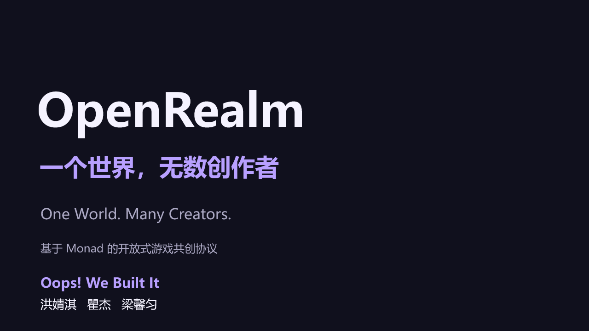
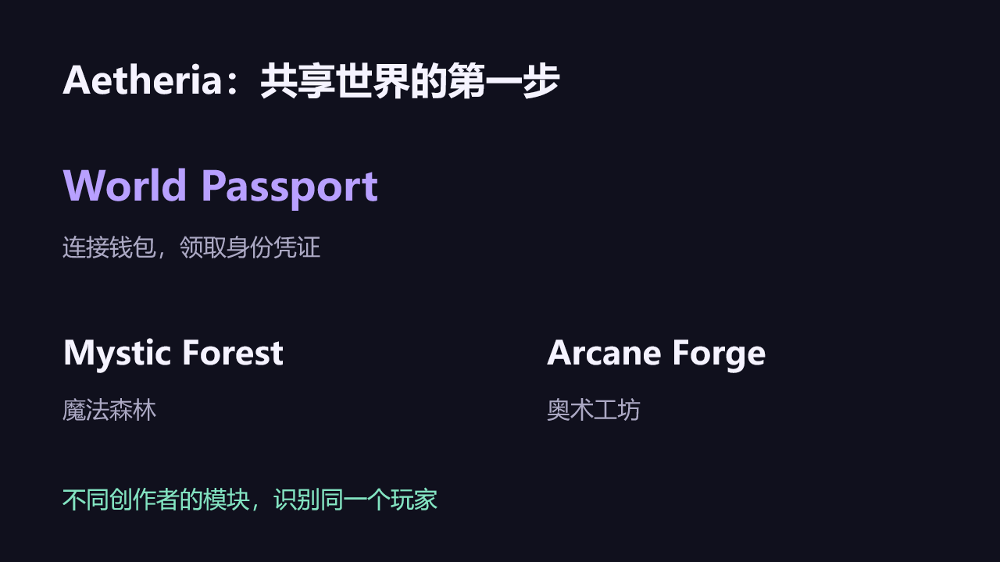
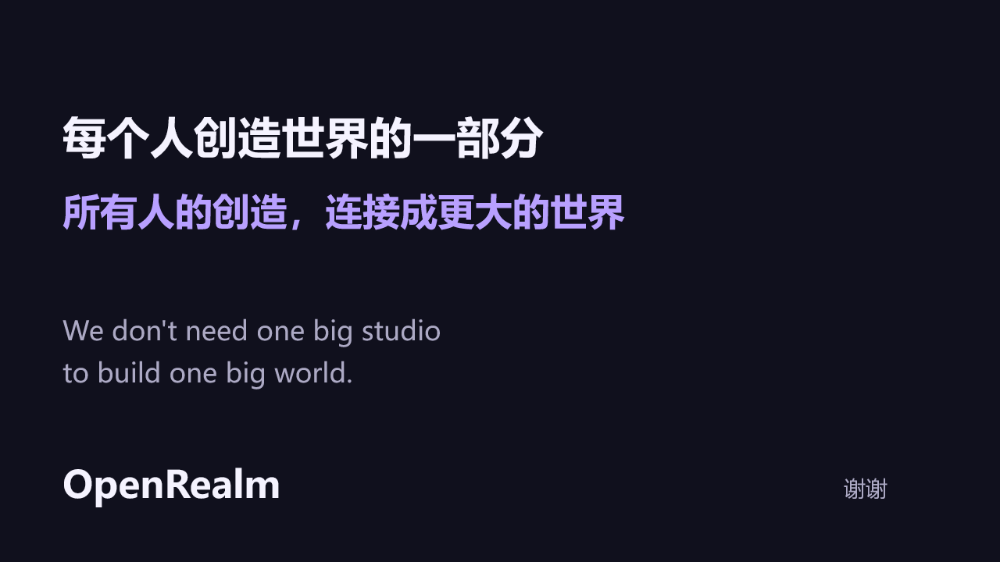

# OpenRealm 路演截图

本页汇集 `.ppt-build/` 中的 7 张路演幻灯片截图，方便评委浏览项目介绍。截图为路演材料；实际功能与资金流请结合 [在线 Demo](https://openrealm-hackathon-demo.rainylark2.chatgpt.site/) 和 [README 中的链上交易证明](README.md#可核验的测试网部署) 核验。

## 页面索引

- [第 1 页：OpenRealm：一个世界，无数创作者](#slide-1)
- [第 2 页：独立创作者，不必独自造一个世界](#slide-2)
- [第 3 页：OpenRealm 的三个核心机制](#slide-3)
- [第 4 页：Aetheria：共享世界的第一步](#slide-4)
- [第 5 页：每次购买，都支持创作者与世界](#slide-5)
- [第 6 页：为什么选择 Monad](#slide-6)
- [第 7 页：每个人创造世界的一部分](#slide-7)

## 第 1 页：OpenRealm：一个世界，无数创作者

[查看原图](.ppt-build/slide-1.png)

## 第 2 页：独立创作者，不必独自造一个世界

[查看原图](.ppt-build/slide-2.png)

## 第 3 页：OpenRealm 的三个核心机制

[查看原图](.ppt-build/slide-3.png)

## 第 4 页：Aetheria：共享世界的第一步

[查看原图](.ppt-build/slide-4.png)

## 第 5 页：每次购买，都支持创作者与世界

[查看原图](.ppt-build/slide-5.png)

## 第 6 页：为什么选择 Monad

[查看原图](.ppt-build/slide-6.png)

## 第 7 页：每个人创造世界的一部分

[查看原图](.ppt-build/slide-7.png)
