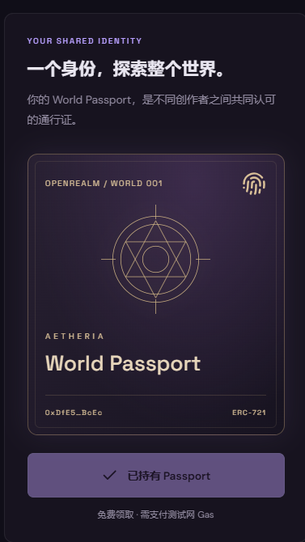
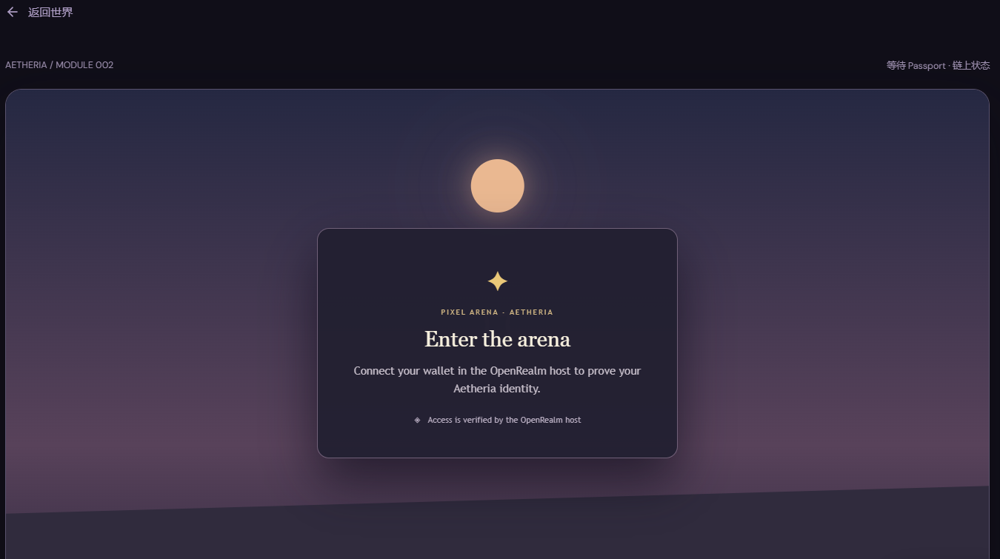
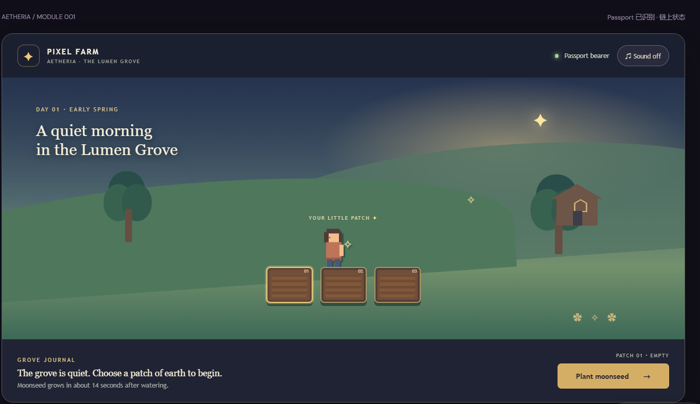
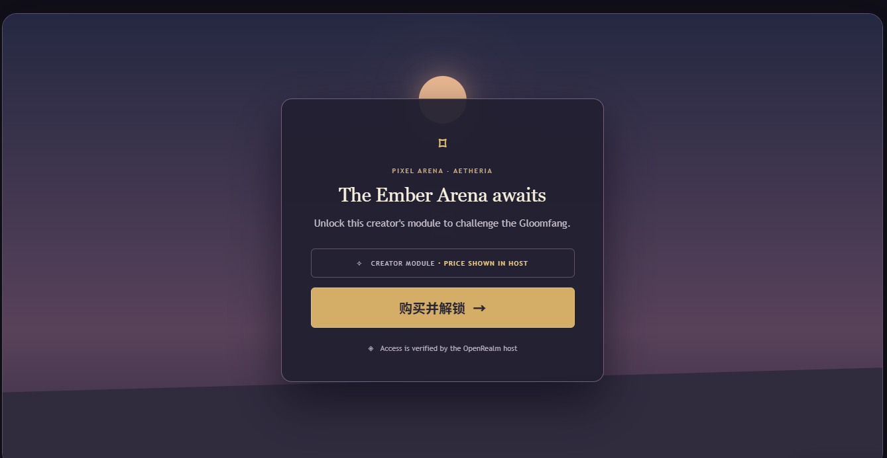
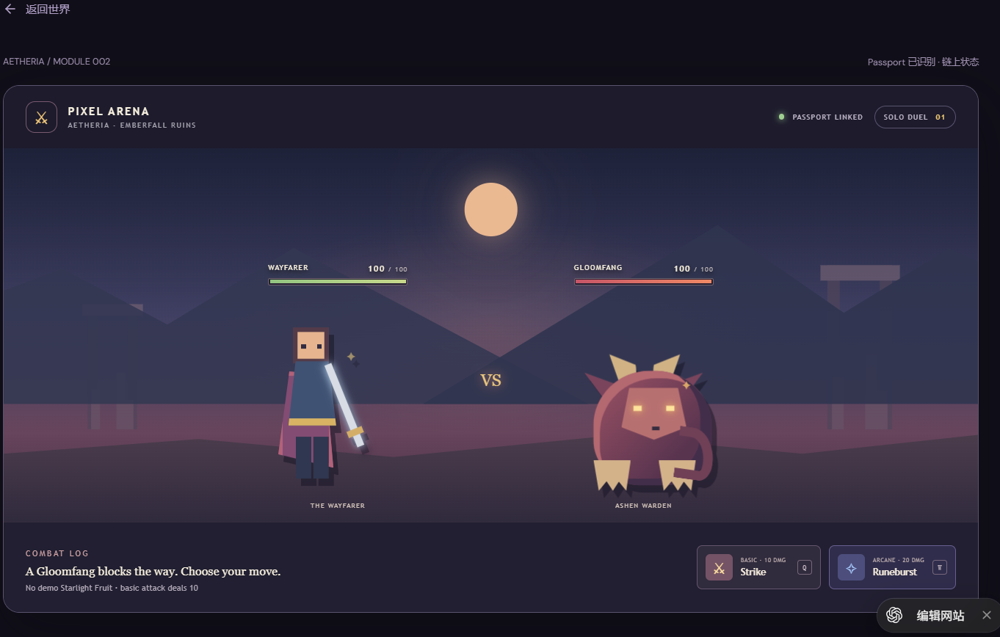
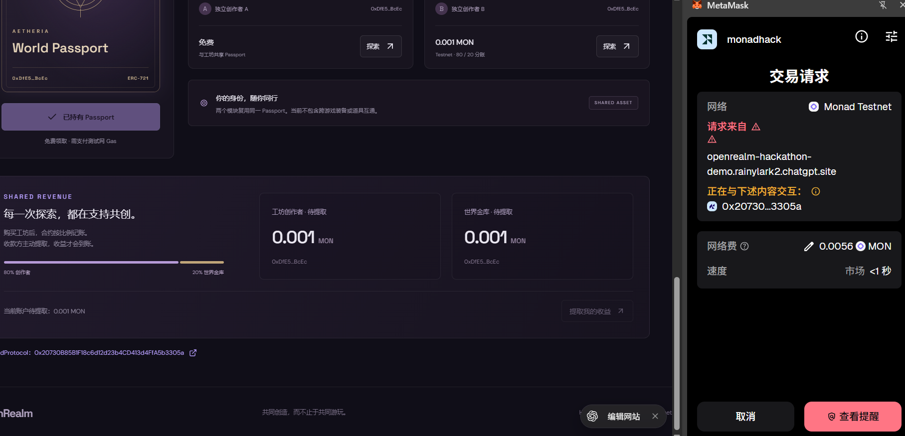
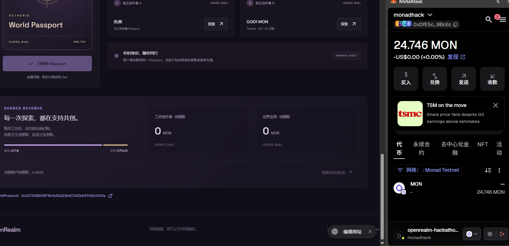

# OpenRealm 产品截图

本页收录 `screenshots/` 中的实际产品截图，按玩家体验流程排列。结合 [在线 Demo](https://openrealm-hackathon-demo.rainylark2.chatgpt.site/) 和 [README 中的合约与交易证明](README.md#可核验的测试网部署)，可核验共享身份、模块解锁和收益结算。截图是特定时刻的页面记录，当前权限与余额以链上状态为准。

## 截图索引

- [1. World Passport 身份卡](#screenshot-1)
- [2. 连接钱包前的游戏入口](#screenshot-2)
- [3. Forest：Pixel Farm 种植场景](#screenshot-3)
- [4. Forge：购买与解锁入口](#screenshot-4)
- [5. Forge：Pixel Arena 战斗场景](#screenshot-5)
- [6. 收益面板与提现交易](#screenshot-6)
- [7. 领取收益到钱包](#screenshot-7)

## 1. World Passport 身份卡

统一入口展示 World Passport 与领取状态，作为两个模块共同识别的玩家身份。

[查看原图](screenshots/worldpassport_claim.png)

## 2. 连接钱包前的游戏入口

未连接钱包时，模块显示连接提示。

[查看原图](screenshots/game_ui_before_wallet_connection.png)

## 3. Forest：Pixel Farm 种植场景

进入农场后，玩家可以选择地块、种植和浇水。

[查看原图](screenshots/game_begin_after_wallet_connection.png)

## 4. Forge：购买与解锁入口

竞技场在购买前显示解锁入口；购买交易需由玩家钱包确认。

[查看原图](screenshots/buy_unlock.png)

## 5. Forge：Pixel Arena 战斗场景

解锁后的竞技场提供普通攻击和技能等战斗操作。

[查看原图](screenshots/Forge_game.png)

## 6. 收益面板与提现交易

展示待提现收益及钱包中的交易记录。此截图不能单独证明提现完成，请结合 README 的提现交易链接核验。

[查看原图](screenshots/get_my_profits.png)

## 7. 领取收益到钱包

钱包余额展示；收益领取结果可结合 README 中的提现交易记录核验。

[查看原图](screenshots/get_mon_to_wallet.png)
